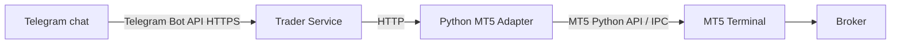

# trading-bot

## Services


## Quick start
1. Скопировать `deploy/compose/trader/.env.example` в `.env` и заполнить (для адаптера аналогично: `python/mt5_adapter/.env.example`). Если trader будет в Docker, в `.env` адаптера нужен `MT5_ADAPTER_HOST=0.0.0.0`
2. `task run:mt5-adapter` — Python-адаптер на Windows с открытым MT5 (всегда нативно, не в Docker)
3. Go-сервис слушает один Telegram-чат и открывает сделки. Запустить одним из способов:
   - в Docker: `task docker:up` (см. [Docker](#docker))
   - нативно: `task run:trader`

## Docker

В контейнере работает только `trader` (`deploy/compose/docker-compose.yml`). MT5-адаптер в Docker не кладём: пакет `MetaTrader5` работает только на Windows и говорит с `terminal64.exe`, поэтому адаптер запускается нативно на Windows рядом с терминалом. Нужны Docker и [Task](https://taskfile.dev); команды одинаковы на Mac и Windows.

Конфиг берётся из того же `deploy/compose/trader/.env`, что и при нативном запуске. В compose подменяются `MT5_ADAPTER_URL` (на `http://host.docker.internal:8080`) и `KILLSWITCH_STATE_FILE` (файл в томе `trader_data`).

| Команда | Что делает |
|---|---|
| `task docker:up` | собрать и поднять trader |
| `task docker:logs` | логи |
| `task docker:down` | остановить (состояние стоп-крана в томе сохраняется) |
| `task docker:build` | только собрать образ |

Адаптер на Windows: `task run:mt5-adapter`, в его `.env` — `MT5_ADAPTER_HOST=0.0.0.0`, порт 8080 разрешить в файрволе.

## Commands

- Run unit-tests:
```
task test:unit
```

- Format:
```
task format
```

- Lint:
```
task lint:do
```
