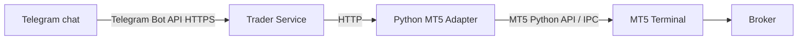

# trading-bot

## Services


## Quick start
1. Скопировать `deploy/compose/trader/.env.example` в `.env` и заполнить (для адаптера аналогично: `python/mt5_adapter/.env.example`)
2. `task run:mt5-adapter` — Python-адаптер на Windows с открытым MT5
3. `task run:trader` — Go-сервис слушает один Telegram-чат и открывает сделки

## Commands

- Run unit-tests:
```
task test:unit
```

- Format:
```
task format
```

- Lint:
```
task lint:do
```
